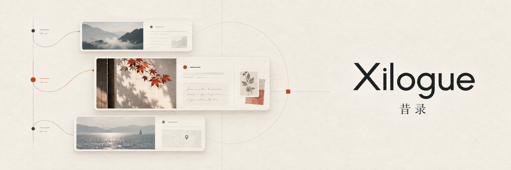
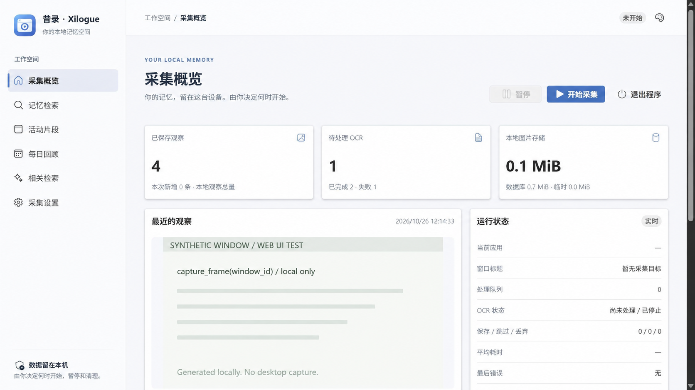
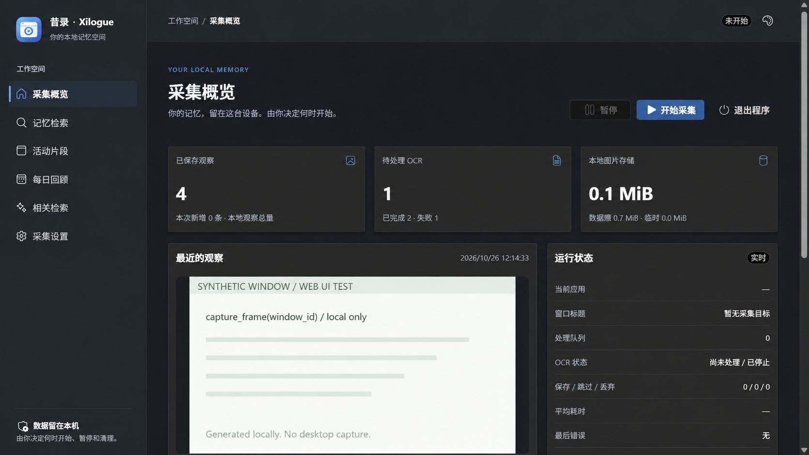

<div align="center">

# 昔录 · Xilogue

**把看过的内容留在本机，需要时找回来。**

`Windows` · `本地优先` · `手动控制采集`

</div>

昔录 · Xilogue 帮你记录前台窗口中的变化，用本地文字搜索和活动线索找回内容，并回到原始画面核对。采集由你主动开始、暂停和清理。

> **开发状态：** P0–P7 功能已实现，项目仍在验收阶段。真实浏览器扩展安装、部分 Windows 实机场景、系统睡眠／关机，以及 1 小时、8 小时和多日运行测试仍待完成。详见[测试与验收](docs/development/testing.md)。
>
> **许可证：** 本项目采用 GNU General Public License v3.0（GPL-3.0-only），详见 [LICENSE](LICENSE)。

## 从记录到找回

1. **主动记录：** 确认当前内容适合保存后开始采集。程序观察前台窗口并跳过近似重复画面；启动时默认停止。
2. **搜索线索：** 使用本地 OCR、应用和时间筛选历史记录，或按活动片段浏览。
3. **回到来源：** 打开原始截图核对上下文；也可自行选择本地模型或 API 提供商生成带来源的摘要、每日回顾和相关检索结果。

## 主要能力

### 记录与查找

- 采集当前前台窗口，支持应用排除、变化检测、暂停、保留期限和容量管理。
- 在本机识别已保存图片中的文字，按关键词、应用、时间和处理状态查找记录。
- 可选浏览器扩展由用户点击后保存当前可见页面；扩展实际安装和权限仍待验收。

### 梳理与回顾

- 按连续活动查看来源，并可拆分、合并或删除片段。
- 自选本地 Ollama 或 OpenAI 兼容 API，摘要与向量可使用不同提供商；API 需明确允许发送文字，密钥由 Windows 当前用户加密保存。[接入说明](docs/development/analysis.md)
- 模型功能可选；生成结果可能有误，应以原始记录为准。

### 控制与数据管理

- 通过本地 Web UI 和系统托盘开始、暂停或退出；每次启动默认停止采集。
- 数据保存在本机，支持记录管理、配额与保留策略、一致性备份和恢复。
- 浏览器扩展使用独立配对；本地服务只监听回环地址。

## 界面预览

以下浅色与深色界面图是基于隔离测试程序和合成数据制作的示意图，不包含真实桌面记录。界面支持跟随系统、浅色和深色主题。



<details>
<summary>查看深色界面</summary>



</details>

## 本地试用（源码）

目前没有完成完整实机兼容性和长期运行验收的正式发行版。下面的步骤用于在 Windows x64 上运行源码，需要 Python 3.11 和 [uv](https://docs.astral.sh/uv/)；在项目根目录执行：

```powershell
uv sync --locked
uv run --locked xilogue
```

程序会启动仅监听 `127.0.0.1` 的本地服务并打开浏览器，**不会自动开始采集**。确认当前内容适合记录后，再点击“开始采集”。

- 停止采集时点击“暂停”，并等待界面显示“已暂停”。
- 点击“退出程序”关闭服务和托盘；关闭网页只会尽力请求暂停，不能代替退出程序。
- 默认数据目录为 `%LOCALAPPDATA%\Xilogue`。隔离试用时可指定专用目录：

```powershell
uv run --locked xilogue --data-dir data/try-xilogue
```

Xilogue 使用新的包名和 `%LOCALAPPDATA%\Xilogue` 数据目录。原 `%LOCALAPPDATA%\PersonalMemory` 目录会原样保留，不会自动迁移或读取；旧名称版本创建的备份不能由 Xilogue 恢复。

普通运行不需要 Node.js。前端与 Python 开发见[开发环境](docs/development/setup.md)；构建和维护 Windows 分发包见[分发说明](docs/development/distribution.md)。

## 隐私与已知边界

- 截图、窗口标题、OCR 文字、索引和反馈保存在本机。进程排除无法识别浏览器中的所有敏感页面；打开私人内容前请先暂停。扩展保存的页面也可能包含可见表单。
- 默认无输入 90 秒后暂缓新采集。长时间阅读或观看视频时可能漏采，可在设置中调整。
- 备份包含原图和文字，**不加密**。请妥善保管；普通删除不保证介质安全擦除。

更多边界见[隐私说明](docs/technical/privacy.md)和[浏览器扩展说明](docs/development/browser-extension.md)。

## 深入了解

- [产品路线](docs/product/roadmap.md) · [系统架构](docs/technical/architecture.md) · [隐私设计](docs/technical/privacy.md)
- [测试与待完成事项](docs/development/testing.md) · [开发环境](docs/development/setup.md) · [本地模型](docs/development/ollama.md)
- [文档总览](docs/README.md) · [Windows 分发与备份恢复](docs/development/distribution.md)
