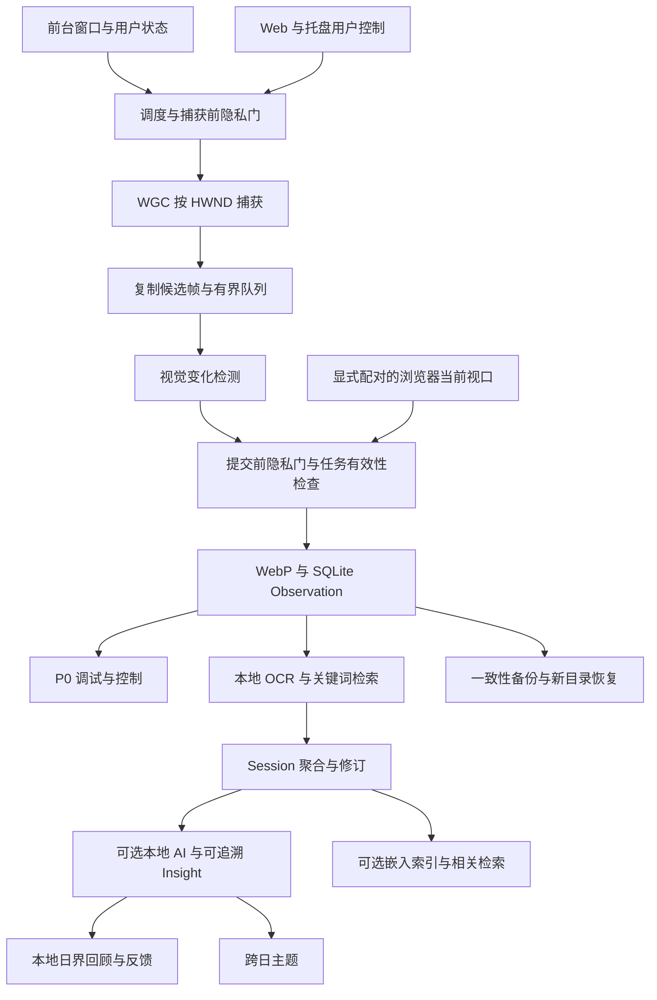

# 架构与模块契约

状态：P0–P7 开发功能已落地：捕获/OCR/分析工作线程、活动、回顾、语义检索、主动浏览器扩展、托盘与备份分发。完整 Windows、用户安装及长测验收未完成。原型经验见 [核对记录](../references/prototype-findings.md)。2026-10-27。

## 四层职责

| 层 | 职责 | 开始阶段 |
| --- | --- | --- |
| Collector | 窗口监控、调度、策略、捕获、候选帧传递 | P0 |
| Memory Engine | 证据存储、生命周期；后续 OCR、索引、Session | P0 起逐步增加 |
| AI Engine | 可恢复的摘要、Insight 与回顾任务 | P3 |
| UI | 采集控制与调试；后续搜索、时间轴、回顾 | P0 起逐步增加 |

分层表示职责隔离，不要求拆分微服务或为每个职责创建单独进程。



## P0 模块

| 职责 | 输入 | 输出与约束 |
| --- | --- | --- |
| Window Monitor | 前台窗口和桌面状态 | HWND、PID、进程名、标题、有效性；标题不能充当窗口唯一标识 |
| Scheduler | 窗口变化、单调时钟、采样参数 | 稳定等待与采样许可；不执行图像编码或磁盘操作 |
| Policy / Privacy Gate | 用户状态、目标、排除、空闲、桌面状态 | 允许或拒绝以及原因；捕获前和提交前均检查 |
| Capture Backend | 已验证目标与 generation | 自有内存帧或结构化错误；不得静默退回整屏截图 |
| Candidate Queue | 候选帧 | 有上限、可失效、有过载计数；不能阻塞原生捕获回调 |
| Change Detector | 当前帧、上次成功保存的参考图、参数 | keep、原因、MAE、变化像素比例、最大局部差异 |
| Persistence | 已通过最终检查的候选 | 证据记录与图片，或可恢复失败 |
| Debug UI | 结构化事件和状态快照 | 开始、暂停、退出、目标、最近结果、队列与错误 |

窗口身份使用 HWND、PID 与进程创建时间，防止句柄复用或旧会话混淆；标题是可变元数据。P0 当前采用可配置轮询，事件钩子留作后续测量优化。

## 捕获适配层

WGC 原生机制是异步帧事件，不强制伪装成每次调用都能立即返回一张图的同步函数。

建议的最小契约：

- `start(target, generation, on_frame, on_error)`：创建指定窗口的捕获会话。
- `stop()` 与停止完成信号：停止接收并确认资源释放，具体阻塞语义由适配层统一。
- `CaptureFrame`：自有图像内存、尺寸、像素格式、真实捕获时间、目标身份、generation、后端与可用的耗时指标。
- `CaptureError`：错误码、可读信息、后端、目标标识、是否可重试。错误文本默认避免泄露标题。
- 明确返回格式、row pitch、帧缓冲区生命周期和尺寸变化处理；以色块及尺寸实验验证转换。

候选帧必须在原生缓冲有效期内复制。回调只做轻量筛选、复制和非阻塞入队，OCR、AI、编码、数据库写入均在回调之外运行。

## 采样与变化检测

窗口切换后等待稳定，取得首张有效候选；持续活动时使用采样间隔节流。没有新帧时不重复声称捕获成功，也不保证固定时间落盘。

保留“最后一次成功保存”的参考图，不能用每次被跳过的候选覆盖它，否则可能漏掉累积的小改动。目标切换及恢复时参考图何时重置应写入测试；不强制跨窗口复用。

P0 用灰度缩略图、全局 MAE、变化像素比例和局部网格差异筛选。持续动画与视频会造成冗余；不得将局部变化直接判为无价值。参数的唯一来源见 [决策记录](decisions.md)。

疑似黑帧或无效帧进入失败诊断。纯黑内容也可能合法，不能把黑帧启发式等同于可靠识别受保护内容。保护机制不可绕过。

## 状态、并发与暂停

控制状态至少区分 stopped、running、pausing、paused、closing、closed；运行中的拒绝原因另行显示，例如 idle、excluded、desktop_unavailable、target_invalid。后端异常不能让界面继续虚报正常采集中。

每次开始新目标、暂停、排除生效或退出，都使旧 generation/token 失效；旧回调及队列任务不得继续提交。

暂停是一个完成屏障：

1. 禁止新候选进入有效处理，失效旧 token，丢弃待处理候选。
2. 与正在提交的任务协调，确保屏障完成时没有可继续提交的旧任务。
3. 等停止条件满足后显示“已暂停”；等待期间显示“正在暂停”，不得先宣布完成。
4. 同步等待原生停止时不得持有回调需要的锁；退出要等待并回收已创建的停止任务。

编码和落盘不得长时间占用窗口监控或 UI 的全局状态锁。具体实现可用独立提交锁或单写入者，但必须通过并发测试证明暂停屏障，不能只凭 token 检查次数推断保证。

在隐私检查与物理提交之间仍可能发生外部窗口变化；应使检查尽量靠近提交并使旧任务尽快失效，如实记录轮询/事件延迟，不能声称完全消除所有竞态。

## 队列与错误

P0 候选图像队列为有界内存队列，过载不阻塞回调。初始可采用丢弃新候选，显示 queue_full 与累计数量；是否改为保留最新候选需要测量，不默认引入更多缓冲。

P0 不要求将未保存的原始候选持久化恢复，暂停或退出应丢弃它们。从 P1 开始，已保存证据的 OCR/AI 等后台处理使用可恢复的持久化任务。

捕获失败、队列满、编码失败、数据库错误、清理失败分开显示，失败不得被记成保存成功。重试有节流，不能让失败窗口持续高速创建捕获线程。

## 存储与后续扩展

P0 数据及生命周期契约见 [数据模型](data-model.md) 和 [隐私规格](privacy.md)。文件与数据库不共享事务，必须有中断恢复和一致性核对，不能仅靠文件重命名称为完整原子提交。

P1 独立 OCR Worker 处理已保存 Observation，失败不阻塞采集。P2 使用规则聚合 Session，不依赖模型。P3 Provider 接口隔离模型；Session 级分析先于 Daily 级汇总，不逐张实时送模型。

当前 OCR 任务状态为 pending / running / done / failed，具备重试上限、错误原因、重启恢复和删除取消语义；后续任务沿用同一语义。模型输出验证结构和来源 ID；缺少来源不能成为有效 Insight。

Engine 的运行模式区分 capture 和 ocr_only，状态机仍为 stopped/running/pausing/paused/closing/closed；运行模式不写入配置或恢复到下次启动。明确发起的 ocr_only 复用现有 Worker 和处理 generation，只领取本轮开始时已到重试时间的来源，不创建捕获后端、不读取前台窗口或输入空闲信息。批次无可领取任务时先释放 OCR 会话，再通过 generation 检查请求自动暂停；旧批次不能暂停后来的运行。它是显式操作，不受自动 OCR 开关限制，继续要求桌面可用。失败退避不在批次内等待，稍后可再发起。

手动暂停保证提交屏障，不承诺打断已在执行的原生推理；Worker 在推理返回且旧结果被丢弃后释放 OCR backend，状态公开 model_loaded 与 pass_finished。退出仍等待线程及推理回收，不能仅凭“已暂停”宣称所有原生计算已经停止。

当前 Web UI 通过回环 API 控制同一 Engine 和 Store，按 [隐私规格](privacy.md) 校验令牌与来源。原生捕获后端仍是 WGC；P6 另提供临时配对扩展的主动可见页面证据通道，复用提交屏障和存储，不提供无授权网页监控。

## 正式工程布局

当前布局和运行命令见 [开发环境](../development/setup.md)。已建立的 P0 业务模块集中于：

```text
src/xilogue/
├── app.py
├── config.py
├── web.py                 # 受保护的回环 API 与服务生命周期
├── static/                # HTML、CSS、JavaScript，随 Python 包分发
├── collector/             # monitor、scheduler、policy、models、backends
├── processing/            # 图像变化、OCR 数据校验与独立 Worker
└── storage/               # 数据库、图片、生命周期
tests/
├── unit/
├── integration/
└── manual/
```

状态机由单个捕获生命周期线程、候选处理线程和维护线程组成；原生捕获线程由后端控制并确认停止。提交使用独立锁，暂停等待该屏障；UI 不等待慢 I/O。数据根目录有跨进程独占锁，避免一个实例的恢复清理删除另一个实例正在提交的图片。当前增加受保护的本机 Web 服务，尚无 AI Provider。

P1 增加一个独立 OCR Worker，按 SQLite 持久任务逐项处理已保存原图。Engine 允许显式注入 CPU OCR 后端，纯捕获实验仍可不注入。每次启动默认不处理；主动开始采集或仅 OCR 批次才领取任务，暂停/退出使独立的 processing generation 失效。窗口变化只重置捕获 generation，不取消无关的已保存来源 OCR。推理在提交锁外执行，写回时共用暂停提交屏障并复查 generation、来源及领取 token。暂停完成可早于不可中断的本地推理结束，但旧结果不得提交；退出等待推理线程和 ONNX 会话释放。

Web API 的数据库查询在后台线程中执行，前端用请求序号和取消信号阻止旧查询覆盖新结果。原始记录与关键词查询统一用游标翻页，界面每页 30 条、列表 API 上限 100；保留既有 `/api/search` 与 CLI 的单次查询上限 500。游标按捕获时间与 ID 定位，不依赖会因删除偏移的 OFFSET；列表排除非 ready 及缺图来源。事件环最多 300、每次最多读取 100，页面最多展示 100 条事件。Uvicorn 限制并发 16、监听 backlog 16、keep-alive 2 秒、HTTP 关闭等待 10 秒。配置修改只在停止/暂停状态串行执行，校验后原子替换文件，再重载引擎。暂停直接失效任务，不等待查询或编码返回。

单条来源操作复用现有 Store 的删除与任务状态机制，变更 API 继续要求随机令牌及同源 JSON POST。删除先提交 deleting 标记并清除派生数据，再清理文件；失败明确返回待清理，维护重试。单条失败重试仅在停止/暂停时重置任务，不启动 Worker。删除后立即刷新存储统计，概览重新核对最近来源，避免继续返回失效图片。普通命令串行锁不阻塞暂停或退出。

服务生命周期线程等待引擎 closed 后关闭 HTTP 服务；退出按钮或终端中断会等待捕获、OCR 等工作线程回收，随后释放端口与数据目录锁。生产代码不再导入 Tkinter；tests/manual 仍保留独立合成窗口和最小测试控制面板。显式 CLI --ocr-once 单独取得数据目录锁后处理当前可领取任务，不创建捕获后端或 Web 服务；失败保留状态并返回非零退出码。
